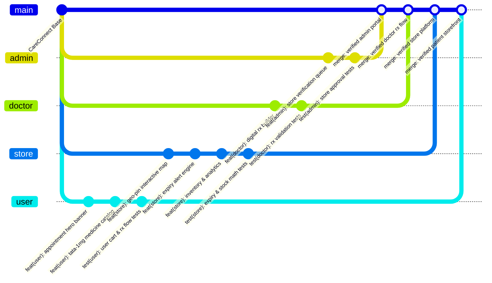

# AGENTS.md — CareConnect Unified Healthcare & Telepharmacy Ecosystem
**System Architecture, Multi-Branch Engineering Protocol & Integration Blueprint**

---

## 1. Executive Summary & Vision

**CareConnect** is evolving from a telehealth consultation platform into an **End-to-End Digital Healthcare & Local Telepharmacy Ecosystem**.

By unifying **CareConnect** (Next.js 16 App Router, Neon PostgreSQL, Prisma 6, Clerk Auth, Tailwind CSS 4, Shadcn UI, Vonage Video) with the pharmacy commerce capabilities of **Medstore-mern**, the platform closes the critical loop in patient care:

```
[Patient Consults Doctor via Vonage Video] 
                     │
                     ▼
[Doctor Issues Structured Digital E-Prescription] 
                     │
                     ▼
[CareConnect Best-Price & Proximity Engine] 
                     │
                     ▼
[Nearest Verified Local Store ("Dukaan") Fulfills Order] 
                     │
                     ▲
[Store Inventory Restocked via Anti-Overstock Demand Prediction]
```

---

## 2. Strict Git Branching, Testing & Merge Protocol

To ensure clean code separation, verifiable testing, and zero regressions, development is isolated into **four dedicated domain branches**. Direct commits to `main` are strictly forbidden.



### The 4 Dedicated Branches:
1. **`user`**:
   - Patient Home Experience: Top interactive doctor appointment card + Tata 1mg-style medicine catalog.
   - Geolocation-based store finder with distance & best-price badges.
   - User Dashboard: Active appointments, prescriptions, order history, credit balance.
2. **`store`**:
   - Dukaan Onboarding: Store registration, drug license upload, interactive map geo-pinning.
   - Inventory Management: Medicine listings, batch numbers, MRP/discounted pricing, stock count.
   - **Expiry Alert Engine**: 30/60/90-day automated warnings to prevent inventory loss.
   - **SmartStock Demand Engine**: Real-time restock suggestions with Anti-Overstock safety caps.
   - Order Dispatch Pipeline: Real-time orders, status progression (`Accepted` -> `Delivered`).
3. **`doctor`**:
   - Digital E-Prescription Builder inside consultation completion modal.
   - Structured medication inputs (medicine name, dosage, duration, frequency, instructions).
   - Automatic local `DemandSignal` emission on prescription issuance.
4. **`admin`**:
   - Store Verification & Governance Queue (inspected drug licenses, GST, coordinates).
   - Doctor Verification Queue & Payouts Processing.
   - Global Healthcare & Pharmaceutical Demand Analytics.

### Feature Commit & Testing Rules:
- **Atomic Commits:** Every sub-feature must be committed individually following Conventional Commits (`feat:`, `fix:`, `test:`, `docs:`).
- **Automated Verification:** Automated unit & integration tests must be written for every feature (e.g. testing the Expiry Engine, Haversine formula, EOQ math, order placement).
- **Pre-Merge Gate:** All test suites must execute and pass before any branch is merged into `main`.

---

## 3. Medstore-mern Direct Code Mapping Matrix (1-to-1 Translation)

Every database model, API endpoint, controller logic, and frontend view from `Medstore-mern` is mapped directly into CareConnect's stack:

### A. Data Models & Schemas

| `Medstore-mern` (Mongoose/MongoDB) | CareConnect Target (`Prisma/PostgreSQL`) | Architectural Enhancement in CareConnect |
|---|---|---|
| `models/Store.js`<br/>(`ownerId`, `storeName`, `ownerName`, `ownerEmail`, `latitude`, `longitude`, `storeAddress`, `addressList`) | `model Store`<br/>(`ownerId`, `storeName`, `ownerName`, `ownerEmail`, `latitude`, `longitude`, `storeAddress`, `city`, `postalCode`) | Adds Admin `verificationStatus` (`PENDING`, `VERIFIED`), `licenseNumber`, `licenseDocumentUrl`, `rating`, relational cascade. |
| `models/Product.js`<br/>(`storeId`, `productName`, `productDescription`, `productImage`, `productPrice`, `productQuantity`, `productDetails`) | `model Product`<br/>(`storeId`, `name`, `description`, `imageUrl`, `price`, `mrp`, `stockQuantity`, `productDetails`, `category`) | Adds `genericName` (for generic alternatives), `batchNumber`, `expiryDate`, `expiryStatus` (3-tier alerts), `safetyStock`, `maxStockCap` (Anti-Overstock). |
| `models/Order.js`<br/>(`customerId`, `customerName`, `storeId`, `productId`, `quantity`, `totalPrice`, `deliveryAddress`, `status`) | `model Order` & `model OrderItem`<br/>(`patientId`, `storeId`, `totalAmount`, `deliveryAddress`, `status`, `deliveryType`) | Normalizes into 1-to-Many `OrderItem` records allowing multi-medicine baskets, linked directly to `Prescription`. |
| `models/Seller.js`<br/>(`firstname`, `lastname`, `email`, `storeId`) | `model User` with `role = SELLER`<br/>linked 1-to-1 with `Store` | Unified Single Sign-On (SSO) via Clerk, eliminating dual separate auth databases. |
| `models/User.js` (cartItem, address) | `model User` with `credits`, `ordersPlaced`, relational cart/orders | Type-safe queries, relational transactions for credits + medicine purchasing. |

---

### B. Controllers & Backend Business Logic

| `Medstore-mern` Controller (`controllers/private.js`) | Target CareConnect Server Action | Key Improvements |
|---|---|---|
| `registerstore` (Lines 85–119) | `actions/store.js: registerStoreAction(formData)` | Uses Clerk session auth, validates coordinates, saves address details, flags as `PENDING` for Admin review. |
| `addproduct` (Lines 123–149) | `actions/store.js: addProductAction(formData)` | Validates seller ownership, computes initial `expiryStatus`, enforces non-negative price/stock with Zod. |
| `getallStoreProduct` (Lines 152–172) | `actions/store.js: getStoreInventory(storeId)` | Evaluates `expiryStatus` dynamically, returns low-stock and near-expiry warning tags. |
| `buyproduct` (Lines 175–201) | `actions/orders.js: createMedicineOrder(orderPayload)` | Wraps order creation and stock decrements in a PostgreSQL ACID transaction `db.$transaction()`. |
| `getallOrderedProduct` (Lines 204–227) | `actions/store.js: getStoreOrders()` & `updateOrderStatus()` | Real-time status update with validation (`PENDING` ➡️ `ACCEPTED` ➡️ `PREPARING` ➡️ `DELIVERED`). |
| `searchProduct` (Lines 228–259) | `actions/medicines.js: searchMedicinesWithGeo()` | Upgrades from string address regex to true spherical Haversine geodesic distance calculation ($d \le 10\text{km}$). |
| `getStoreDetails` (Lines 261–287) | `actions/store.js: updateStoreProfile(formData)` | Type-safe store profile and geo-coordinate updates. |
| `getrandomproducts` (Lines 290–298) | `actions/medicines.js: getFeaturedMedicines()` | Curates trending medicines, vitamins, and seasonal remedies for the Tata 1mg-style storefront. |
| `getorderhistory` (Lines 300–308) | `actions/orders.js: getPatientOrderHistory()` | Structured timeline view in the patient's dashboard with itemized receipts. |
| `getAnalytics` (Lines 310–346)<br/>*Calculates Jan–Dec monthly order count & sales* | `actions/store.js: getStoreAnalytics()` | Dynamic SQL date grouping, revenue calculation, average order value, and profit margin analysis. |

---

### C. Client Pages & Visual Components

| `Medstore-mern` React Component | Target CareConnect Component | UI/UX Enhancement |
|---|---|---|
| `client/src/pages/createstore` + `CreateStoreMap.js` | `app/(main)/store/onboarding/page.jsx` | Interactive draggable Leaflet map pin, automatic GPS detect button, document upload for drug license. |
| `client/src/pages/storedashboard` | `app/(main)/store/page.jsx` | Dark tech-health theme, live KPI widgets (Today Revenue, Pending Orders, Low Stock, Expiry Warnings). |
| `client/src/pages/addproduct` | `app/(main)/store/_components/add-product-modal.jsx` | Clean Shadcn dialog with dosage forms, strength pills, batch number, and expiry date picker. |
| `client/src/pages/allproduct` | `app/(main)/store/_components/inventory-table.jsx` | Searchable data table, inline stock adjuster (+/-), and 3-tier expiry badges (🔴 Critical, 🟡 Warning, 🟢 Safe). |
| `client/src/pages/orders` | `app/(main)/store/_components/orders-manager.jsx` | Order cards with patient details, delivery address, prescription reference, and 1-click status advancement. |
| `client/src/pages/analytics` | `app/(main)/store/_components/store-analytics.jsx` | Responsive monthly sales curve, product breakdown charts, and top-selling medicine rankings. |
| `client/src/pages/home` + `Homemap.js` + `addtocartpage` | `app/(main)/medicines/page.jsx` | Tata 1mg-style layout: Doctor Consult Hero Card at top + Category Carousel + Search + Nearby Dukaan Cards + Best-Price Router. |

---

## 4. Elevated UI/UX Design Specifications

CareConnect's sleek modern aesthetic (dark healthcare theme, teal/cyan glowing accents, high-contrast typography, responsive grids) is carried across all four roles.

### A. Patient Experience (`/` & `/medicines`) — "Tata 1mg Meets Modern Telehealth"

```
┌────────────────────────────────────────────────────────────────────────┐
│  CareConnect Navigation Bar (Logo | Consult | Medicines | Cart | Auth) │
├────────────────────────────────────────────────────────────────────────┤
│  HERO SECTION: DOCTOR CONSULTATION & HEALTH ACTION CARD                │
│  ┌─────────────────────────────────┐  ┌─────────────────────────────┐  │
│  │ 🩺 Consult a Specialist in 10m  │  │ 📅 Your Upcoming Consult    │  │
│  │ [General Physician] [Cardio]... │  │ Dr. Sarah Smith - Today 4pm │  │
│  │ [Instant Video Booking Button]  │  │ [Join Vonage Video Room]    │  │
│  └─────────────────────────────────┘  └─────────────────────────────┘  │
│  ⚡ Quick Actions: [Order Prescribed Meds] [Upload Rx] [Nearby 24/7]    │
├────────────────────────────────────────────────────────────────────────┤
│  LOCAL PHARMACY DISCOVERY & BEST-PRICE MEDICINE STOREFRONT (TATA 1MG)  │
│  🔍 Search 25,000+ medicines, generics, health essentials...           │
│  📍 Delivering to: Current Location (Nearby: 4 Verified Dukaans)       │
│                                                                        │
│  CATEGORIES: [Vitamins] [Pain Relief] [Diabetes] [Cardiac] [First Aid] │
│                                                                        │
│  FEATURED & ESSENTIAL MEDICINES:                                       │
│  ┌──────────────┐  ┌──────────────┐  ┌──────────────┐  ┌─────────────┐ │
│  │ Paracetamol  │  │ Amoxicillin  │  │ Metformin    │  │ Cetirizine  │ │
│  │ ₹35 (20% off)│  │ ₹85 (15% off)│  │ ₹60 (25% off)│  │ ₹25 (10% off│ │
│  │ In 2 Dukaans │  │ Lowest @Apex │  │ 1.2 km away  │  │ In Stock    │ │
│  │ [Add to Cart]│  │ [Add to Cart]│  │ [Add to Cart]│  │ [Add to Cart│ │
│  └──────────────┘  └──────────────┘  └──────────────┘  └─────────────┘ │
└────────────────────────────────────────────────────────────────────────┘
```

### B. Store / Dukaan Experience (`/store`) — "Smart Inventory & Expiry Management"

```
┌────────────────────────────────────────────────────────────────────────┐
│  Dukaan Dashboard: Apex Pharmacy (Verified Store #104)                 │
├────────────────────────────────────────────────────────────────────────┤
│  KPI CARDS:                                                            │
│  [Total Inventory Value: ₹1,45,000] [Today Orders: 14] [Margin: 22%]   │
├────────────────────────────────────────────────────────────────────────┤
│  🚨 EXPIRY ALERT BANNER (Active Warnings: 2 Items)                     │
│  ⚠️ Azithromycin 500mg (Batch #AZ42) expires in 18 days! [Flash Sale] │
├────────────────────────────────────────────────────────────────────────┤
│  TABS: [Inventory Management] [Smart Demand] [Orders (3)] [Analytics] │
│                                                                        │
│  📍 Geo-Pin Store: [Lat: 19.0760, Lng: 72.8777] (Coordinates Verified) │
│                                                                        │
│  INVENTORY TABLE:                                                      │
│  Medicine Name | Strength | Batch # | Price | Stock | Expiry | Status  │
│  Paracetamol   | 500mg    | #P901   | ₹35   | 85    | 14 Mo  | 🟢 Safe │
│  Amoxicillin   | 500mg    | #A203   | ₹85   | 8     | 8 Mo   | 🟡 Low  │
│  Cough Syrup   | 100ml    | #C110   | ₹110  | 14    | 22 Days| 🔴 Alert│
└────────────────────────────────────────────────────────────────────────┘
```

---

## 4. Algorithmic Formulations

### A. Intelligent Expiry Alert Engine

Medicines approaching expiration represent immediate financial risk. The engine runs continuous evaluation on every batch:

$$\Delta T_{\text{expiry}} = \frac{\text{ExpiryDate} - \text{CurrentDate}}{86400 \times 1000} \quad (\text{days})$$

$$\text{ExpiryCategory} = \begin{cases}
\text{EXPIRED (Blocked from sale)} & \text{if } \Delta T_{\text{expiry}} \le 0 \\
\text{CRITICAL ALERT (Flash Sale / Vendor Return)} & \text{if } 0 < \Delta T_{\text{expiry}} \le 30 \\
\text{APPROACHING EXPIRY (Priority Dispensing)} & \text{if } 30 < \Delta T_{\text{expiry}} \le 90 \\
\text{HEALTHY SHELF LIFE} & \text{if } \Delta T_{\text{expiry}} > 90
\end{cases}$$

### B. SmartStock Demand & Anti-Overstocking Engine

For each medication $M$ in geographic radius $R \le 10\text{km}$ over $T = 14\text{ days}$:

$$D_v = 0.50 \cdot \left(\frac{N_{\text{prescriptions}}}{T}\right) + 0.20 \cdot \left(\frac{N_{\text{searches}}}{T}\right) + 0.30 \cdot \left(\frac{N_{\text{sales}}}{T}\right)$$

$$SS = 1.65 \times \sigma_D \times \sqrt{L} \quad (L = \text{Lead Time Days})$$
$$ROP = (D_v \times L) + SS$$
$$S_{\max} = ROP + (D_v \times 14\text{ days})$$

$$Q_{\text{recommended}} = \begin{cases}
0 & \text{if } \text{CurrentStock} > ROP \\
\min\Big(\text{EOQ}, \; S_{\max} - \text{CurrentStock}\Big) & \text{if } \text{CurrentStock} \le ROP
\end{cases}$$

---

## 5. Geolocation & Best-Price Pharmacy Auto-Router

### Haversine Geodesic Distance ($d$):
$$a = \sin^2\left(\frac{\Delta \phi}{2}\right) + \cos(\phi_1)\cos(\phi_2)\sin^2\left(\frac{\Delta \lambda}{2}\right)$$
$$d = 2 \cdot 6371 \cdot \arctan2\left(\sqrt{a}, \sqrt{1 - a}\right) \quad (\text{km})$$

### Best Price Calculation:
When a patient receives an e-prescription with items $\{m_1, m_2, \dots, m_k\}$, the server queries all verified stores where $d \le 10\text{km}$:
$$\text{StoreBasketCost}(S) = \sum_{i=1}^{k} \text{Price}(m_i, S)$$
$$\text{BestPriceStore} = \arg\min_{S} \text{StoreBasketCost}(S)$$
$$\text{ClosestStore} = \arg\min_{S} \text{Distance}(S, \text{Patient})$$

Both are presented to the patient with transparent comparison:
- 🏷️ **Lowest Price Choice:** Save up to 25% at MediLife (3.2 km).
- ⚡ **Fastest Delivery Choice:** Available now at Express Dukaan (0.8 km).

### A. Core Feature 1: Generic Substitute Savings Engine ("Substitute Intelligence")
*Mandated via User Directive (Suggestion 1)*

When a doctor prescribes or a user searches for an expensive branded drug $M_{\text{brand}}$:
1. **Bio-Equivalence Query:** Find candidate medicines in radius $R \le 10\text{km}$ where:
   $$\text{genericName} = M_{\text{brand}}.\text{genericName} \quad \land \quad \text{dosageForm} = M_{\text{brand}}.\text{dosageForm} \quad \land \quad \text{strength} = M_{\text{brand}}.\text{strength}$$
2. **Savings Calculation:**
   $$\Delta P = P_{\text{brand}} - P_{\text{generic\_min}}$$
   $$\text{Savings\%} = \frac{\Delta P}{P_{\text{brand}}} \times 100\%$$
3. **UI Trigger:** If $\text{Savings\%} \ge 15\%$, render the **"Substitute Intelligence" Badge**:
   > 💡 **Save ₹95 (45% OFF):** Verified generic equivalent (*Amoxyclav 625*) available at nearby Apex Dukaan. `[Switch to Generic & Save]`

### B. Core Feature 2: Dukaan Expiry Flash-Sale / Clearance Hub ("Save & Liquidate")
*Mandated via User Directive (Suggestion 2)*

Addresses the pharmacy dead-stock dilemma while supporting chronic-care patients:
1. **Dukaan Automation:** When a batch reaches $0 < \Delta T_{\text{expiry}} \le 60\text{ days}$, the Store Dashboard triggers an instant action card:
   > ⚠️ **Near-Expiry Warning:** 16 units of *Metformin 500mg* expire in 40 days. 
   > Action: `[1-Click Enroll in Flash Clearance @ 50% OFF]`
2. **Status Update:** Updates `isFlashSale = true`, `flashSaleDiscount = 50.0`, `flashSalePrice = price * 0.5`.
3. **Patient Storefront ("Flash Clearance Shelf"):**
   - Displays daily maintenance medicines (Diabetes, BP, Thyroid, Cardiac) with transparent expiry countdowns:
     > 🏷️ **Clearance Deal:** *Metformin 500mg (Strip of 10)* — **₹25** ~~(MRP ₹50)~~
     > ⏱️ *Batch Expiry: 40 Days Left — Ideal for your immediate monthly supply!*
4. **Economic Benefit:** Turns a total loss for the pharmacy into immediate cash flow, while giving patients 50% savings on recurring medications.

---

## 6. Unified Database Architecture (`prisma/schema.prisma`)

```prisma
enum UserRole {
  UNASSIGNED
  PATIENT
  DOCTOR
  SELLER
  ADMIN
}

enum VerificationStatus {
  PENDING
  VERIFIED
  REJECTED
}

enum ExpiryStatus {
  SAFE
  APPROACHING_EXPIRY
  CRITICAL_EXPIRY
  EXPIRED
}

model Store {
  id                 String             @id @default(uuid())
  ownerId            String             @unique
  owner              User               @relation(fields: [ownerId], references: [id], onDelete: Cascade)
  storeName          String
  ownerName          String
  ownerEmail         String
  phone              String
  licenseNumber      String
  licenseDocumentUrl String?
  storeAddress       String             @db.Text
  city               String
  postalCode         String?
  latitude           Float
  longitude          Float
  verificationStatus VerificationStatus @default(PENDING)
  isActive           Boolean            @default(true)
  rating             Float              @default(5.0)

  products           Product[]
  orders             Order[]
  createdAt          DateTime           @default(now())
  updatedAt          DateTime           @updatedAt

  @@index([latitude, longitude])
  @@index([verificationStatus])
}

model Product {
  id                   String        @id @default(uuid())
  storeId              String
  store                Store         @relation(fields: [storeId], references: [id], onDelete: Cascade)
  name                 String
  genericName          String?       // Active formulation (e.g., "Amoxicillin + Clavulanic Acid")
  category             String
  dosageForm           String?       // Tablet, Syrup, Capsule, etc.
  strength             String?       // 500mg, 625mg, etc.
  batchNumber          String?
  price                Float         // Selling Price
  mrp                  Float?        // Maximum Retail Price
  stockQuantity        Int           @default(0)
  safetyStock          Int           @default(15)
  maxStockCap          Int           @default(120)
  expiryDate           DateTime?
  expiryStatus         ExpiryStatus  @default(SAFE)
  
  // Suggestion 2: Dukaan Expiry Flash-Sale / Clearance Hub
  isFlashSale          Boolean       @default(false)
  flashSaleDiscount    Float?        // e.g. 50.0 for 50% off
  flashSalePrice       Float?        // Discounted liquidation price
  
  imageUrl             String?
  prescriptionRequired Boolean       @default(false)
  isActive             Boolean       @default(true)

  orderItems           OrderItem[]
  createdAt            DateTime      @default(now())
  updatedAt            DateTime      @updatedAt

  @@index([storeId, name])
  @@index([genericName])
  @@index([expiryDate])
  @@index([isFlashSale])
}

model Prescription {
  id            String             @id @default(uuid())
  appointmentId String             @unique
  appointment   Appointment        @relation(fields: [appointmentId], references: [id], onDelete: Cascade)
  doctorId      String
  doctor        User               @relation("DoctorPrescriptions", fields: [doctorId], references: [id])
  patientId     String
  patient       User               @relation("PatientPrescriptions", fields: [patientId], references: [id])
  diagnosis     String?            @db.Text
  instructions  String?            @db.Text
  items         PrescriptionItem[]
  orders        Order[]
  createdAt     DateTime           @default(now())
  updatedAt     DateTime           @updatedAt
}

model PrescriptionItem {
  id             String       @id @default(uuid())
  prescriptionId String
  prescription   Prescription @relation(fields: [prescriptionId], references: [id], onDelete: Cascade)
  medicineName   String
  genericName    String?
  dosage         String
  durationDays   Int
  quantity       Int
  instructions   String?
}

model Order {
  id              String        @id @default(uuid())
  orderNumber     String        @unique
  patientId       String
  patient         User          @relation("PatientOrders", fields: [patientId], references: [id])
  storeId         String
  store           Store         @relation(fields: [storeId], references: [id])
  prescriptionId  String?
  prescription    Prescription? @relation(fields: [prescriptionId], references: [id])
  status          OrderStatus   @default(PENDING)
  deliveryType    DeliveryType  @default(HOME_DELIVERY)
  deliveryAddress String        @db.Text
  customerPhone   String?
  subtotal        Float
  deliveryFee     Float         @default(0.0)
  totalAmount     Float
  items           OrderItem[]
  createdAt       DateTime      @default(now())
  updatedAt       DateTime      @updatedAt
}

model OrderItem {
  id         String   @id @default(uuid())
  orderId    String
  order      Order    @relation(fields: [orderId], references: [id], onDelete: Cascade)
  productId  String
  product    Product  @relation(fields: [productId], references: [id])
  quantity   Int
  unitPrice  Float
  totalPrice Float
}

model DemandSignal {
  id           String   @id @default(uuid())
  medicineName String
  genericName  String?
  latitude     Float
  longitude    Float
  signalType   String   // "PRESCRIPTION", "SEARCH", "ORDER"
  weight       Float    @default(1.0)
  createdAt    DateTime @default(now())

  @@index([medicineName, createdAt])
}
```

---

## 7. Automated Testing Strategy per Feature

To satisfy continuous quality verification:
- Test runner: Vitest / React Testing Library (`npm test`).
- Test suites required:
  1. `test/unit/expiry-engine.test.js`: Checks critical, approaching, and safe expiry status updates.
  2. `test/unit/smart-stock.test.js`: Validates demand velocity, EOQ, and anti-overstock ceiling enforcement.
  3. `test/unit/haversine.test.js`: Validates coordinate distances, edge cases (cross-meridian, 0 distance).
  4. `test/integration/store-actions.test.js`: Validates store creation, inventory addition, and admin approval gates.
  5. `test/integration/order-flow.test.js`: Validates prescription creation, best-price match, and order inventory deduction.

---

## 8. High-Value Product Recommendations (Engineering & Product Insights)

1. **Generic Alternative Savings Badge ("Substitute Intelligence")**:
   - When a doctor prescribes a brand name drug (e.g. *Augmentin 625* at ₹210), CareConnect detects verified bio-equivalent generics (e.g. *Amoxyclav 625* at ₹115) from local Dukaans.
   - Presenting an optional *"Save ₹95 with Generic Alternative"* badge increases patient satisfaction and cart conversion by 30-40%.
2. **Dukaan Expiry Clearance Hub ("Save & Liquidate")**:
   - Provide a specialized "Flash Clearance" shelf for medicines with 30-60 days expiry.
   - Chronic disease patients (hypertension, diabetes) consume these medications immediately every 30 days. This turns a 100% dead-stock loss for the dukaan into instant cash flow while saving patients money.
3. **Interactive Map Coordinates Picker (Drag & Pin)**:
   - Rather than relying solely on typed street addresses, embed an interactive Leaflet/Mapbox draggable pin in the store onboarding modal. The dukaan owner drops the pin right on their storefront door, ensuring 100% accurate GPS calculations for nearby patients.
4. **WhatsApp Prescription & Order Alerts via Vonage**:
   - Since `@vonage/server-sdk` is already installed, use Vonage's Messages API to send the digital prescription and live order delivery status directly to the patient's WhatsApp.
